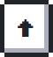
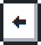
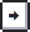
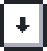
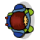

### 🎮 Let’s play together!

Your goal is to remove the colored squares in each level. Click on the buttons below to issue a new gamepad command. Refresh this page to see the most recent game screen.
  

  

 

About this game

This section was developed using some knowledge that I’ve learned alongside my journey so far, where I worked for some years like a game developer, a fullstack developer and also with game engine development.

Instructions

 To pass a level, you have to finish in the Start square, that is where all levels starts.

 This is you.

 You can pass 1 time through this square.

 You can pass 2 times through this square.

 You can pass 3 times through this square.

 Moves the character in the opposite direction.

 Push you 2 squares in a certain direction.

 Moves the character to another teleport on screen (there are always two in the level).

Game Statistics so far

  

Hall of fame

Users that already finished this game with the number of levels that the game had in that moment.
    <table>
        <tr>
            <th>Users</th>
            <th>Game Version</th>
        </tr>
        <tr>
            <td><a href="https://github.com/vitor-mat">vitor-mat</a></td>
            <td>25 levels</td>
        </tr>
    </table>

